# 陕铺后台操作教程

更新日期：2026年11月13日。截图使用演示数据，商品、价格和库存以实际后台为准。图中的红色编号标出操作位置。

## 01｜操作入口

| 操作 | 入口 | 章节 |
| --- | --- | --- |
| 把微信里显示的小程序名称改成“陕铺” | 微信公众平台，由小程序管理员操作 | 03 |
| 改商品名称、分类、简介 | 商品管理 → 商品列表 → 编辑 | 04、05 |
| 改商品图片、详情内容 | 商品编辑页 → 图片设置 / 商品详情 | 06、07 |
| 改售价、规格价格 | 商品编辑页 → 价格与库存 / SKU | 08 |
| 到货补库存、盘点减库存 | 商品管理 → 库存工作台 | 10 |
| 暂停销售或恢复销售 | 商品列表 → 下架 / 上架 | 11 |
| 增加一个新商品 | 商品列表 → 新增商品 | 12 |
| 更换首页大图、频道、推荐品牌、专题 | 可视化装修 → 实时预览与编辑 | 13 |
| 改错了，想恢复 | 未保存时放弃修改；已保存时核对回退记录 | 14 |
| 不知道哪里出问题 | 按现象排查 | 16 |

## 02｜打开后台并登录

向交付负责人领取正式后台网址、个人账号和密码。截图中的本地地址仅供演示，登录时使用负责人提供的网址。

1. 在电脑浏览器中打开后台网址，确认页面显示“陕铺管理后台”。
2. 在图中 **①账号** 输入分配给您的账号。
3. 在 **②密码** 输入密码。注意大小写和空格。
4. 点击 **③登录**。
5. 登录后会进入账号有权限的页面。如果尚未打开商品列表，点击左侧“商品管理”，再点击“商品列表”。

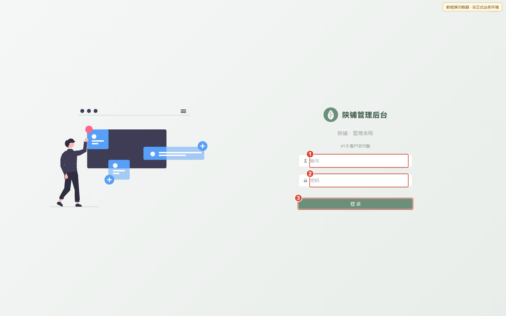

如果看到“当前账号无权访问该功能”，点“返回工作台”。如果缺少“商品管理”菜单或“编辑”按钮，请负责人检查商品权限。

## 03｜修改小程序名称

| 名称 | 客户在哪里看到 | 由谁修改 |
| --- | --- | --- |
| 微信官方小程序名称 | 微信搜索、最近使用的小程序、账号资料 | 小程序管理员在微信公众平台修改 |
| 应用内品牌文字 | 小程序首页左上角、登录页、分享标题等 | 维护人员更新并发布小程序版本 |
| 商品名称 | 商品列表、搜索、商品详情 | 运营人员在本后台编辑 |

小程序名称使用“陕铺”。应用名称和默认导航标题已设置为“陕铺”，更新后需重新发布小程序；微信官方名称由管理员在公众平台单独修改。

### 3.1 修改微信官方名称

1. 请持有该小程序管理权限的人打开 [微信公众平台](https://mp.weixin.qq.com/)。
2. 登录对应的小程序账号；如果该账号管理多个小程序，先确认进入的是“陕铺”对应的账号。
3. 进入账号设置，找到显示当前“小程序名称”的资料项。页面布局和修改入口以您登录后的微信页面为准。
4. 如果当前名称已经是“陕铺”，只需核对；如果仍有“Test”等后缀，使用名称旁的修改入口，填写 **陕铺**。
5. 按微信页面提示完成管理员确认或审核。能否修改、所需资料、次数和生效时间，以平台当前提示为准。
6. 完成后重新打开账号资料核对名称，再用微信搜索或重新进入小程序检查显示。

找不到修改入口或名称未通过时，将页面提示发给小程序账号负责人处理。改名沿用原有 AppID。

### 3.2 应用内文字和“品牌管理”的区别

“内容管理 → 品牌管理”用于维护首页推荐品牌，例如“陕铺优选”。微信官方名称在公众平台维护；首页固定的“陕铺”标题如需调整，由维护人员更新并发布小程序。

商品名称、价格和图片在商品编辑页修改，操作见下文。

## 04｜查找商品

入口：**商品管理 → 商品列表**。

1. 在图中 **①商品名称** 输入完整名称或一部分，例如“桂圆”。
2. 点击 **②搜索**。也可以选分类、状态缩小范围。
3. 在结果中核对主图、商品名称、分类和当前售价，确认是目标商品。
4. 点击这一行最右侧的 **③编辑**，进入后核对名称和图片。如果按钮被挡住，拖动表格底部横向滚动条向右查看。
5. 找不到商品时，先点击“重置”，清除之前的分类或状态条件，再搜索一次。

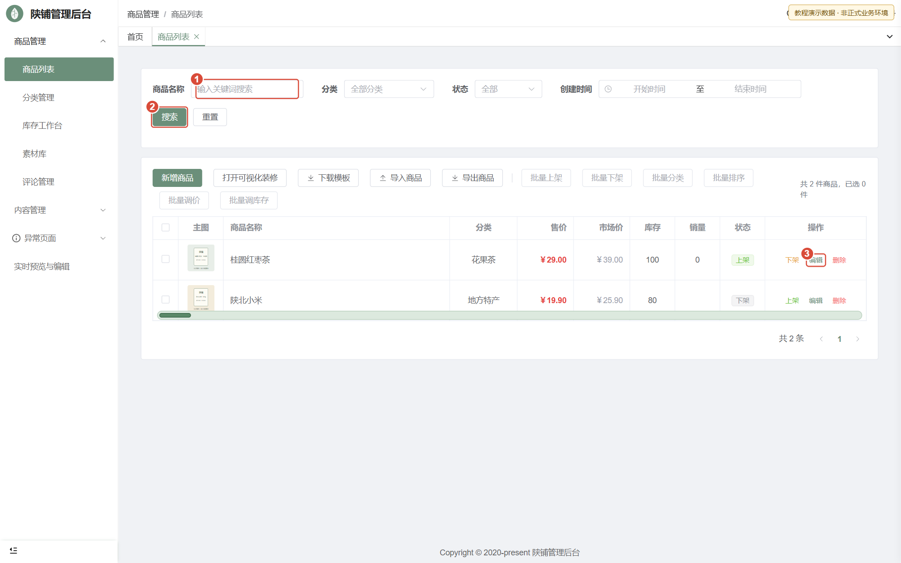

## 05｜改商品名称、分类、关键词和简介

进入商品编辑页顶部的“基础信息”。

1. 在图中 **①商品名称** 修改名称。例如将“桂圆红枣茶”改成“桂圆红枣茶 10袋装”。不要留空。
2. 在 **②商品分类** 选择已启用的分类。改完后，顾客会在对应分类中找这个商品。
3. 商品类型一般保持原值；实体食品通常选择“实物商品”。
4. 在“关键词”中逐个选择搜索词。要加一个新词，输入后在下拉列表中选中该词，例如“花果茶”“茶饮”“红枣”。
5. 在 **③简介** 写一两句简短说明，例如“独立小袋包装，日常冲泡方便”。
6. 只改这些内容时，保留原价格、库存和规格。完成后按第09节保存。

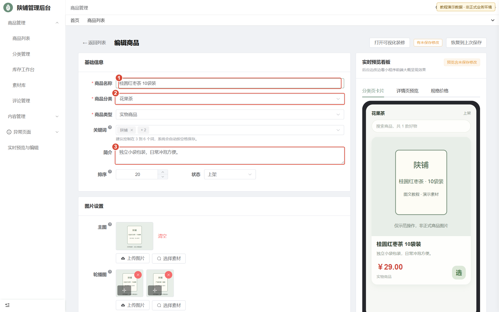

排序数值越大，商品通常越靠前；保留原值即可维持现有排序。

## 06｜改主图、轮播图和选择素材

向下滚动到“图片设置”。

| 图片种类 | 用途 | 如何选择 |
| --- | --- | --- |
| 主图 | 商品列表中的封面 | 选清楚、完整的商品正面图 |
| 轮播图 | 商品详情顶部可左右滑动的图片 | 展示正面、背面、包装等不同角度 |
| 详情图 | 商品详情下方的长图说明 | 在下一节的“商品详情”区域添加 |

### 6.1 电脑上已有新图片

1. 找到要替换的主图或轮播图区域，点击图中 **①上传图片**。
2. 在电脑文件窗口中选择图片并确认。
3. 等到页面提示“上传成功”，并检查该区域已出现新图片。
4. 主图展示一张，轮播图最多10张。轮播图已满时，先移除要替换的旧图。拖动图片上的手柄可调整顺序。
5. 图片上传完成后，点击“保存修改”，将新图保存到商品。

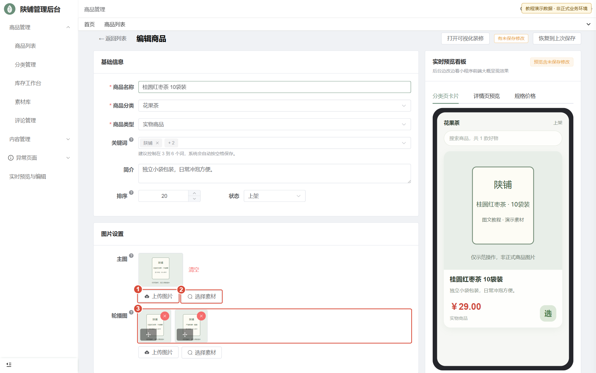

### 6.2 图片已在素材库中

1. 点击图4中的 **②选择素材**。
2. 在弹窗图5的 **①搜索框** 输入图片文件名的一部分，点“查询”。
3. 点击 **②目标图片**。选择主图时会带回图片并关闭窗口；选择轮播图或详情图时，可以继续选择其他图片。
4. 多图选择完成后，点 **③完成**，返回编辑页检查。

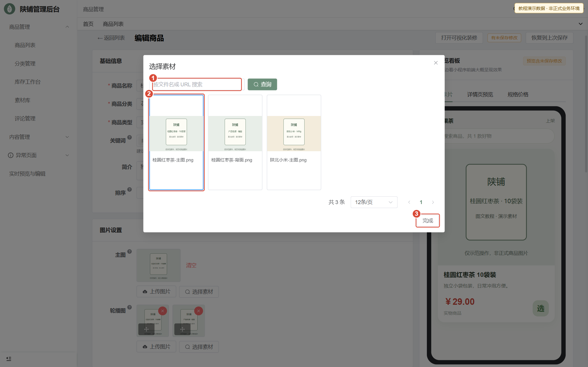

上传支持 JPG、PNG、WebP，单张不超过5MB。主图选用清晰、接近正方形的商品原图，避免使用聊天截图。

轮播图第一张放正面图，后面放细节和包装。点击图片右上角的叉号，可将该图从商品图片列表移除；调整后点击“保存修改”。

## 07｜改商品详情文字和详情图

向下找到“商品详情”。

1. 在图中 **①详情内容** 填写顾客需要了解的信息，如规格、配料、食用方式和保存方式。
2. 图片在下方“详情图”区域添加：点击 **②上传图片** 或 **③选择素材**。
3. 详情图最多20张。添加多张时，按顾客阅读顺序排列。
4. 点击右侧的“详情页预览”标签，检查文字和图片是否与目标商品对应。
5. 继续核对价格和规格，再按第09节保存。

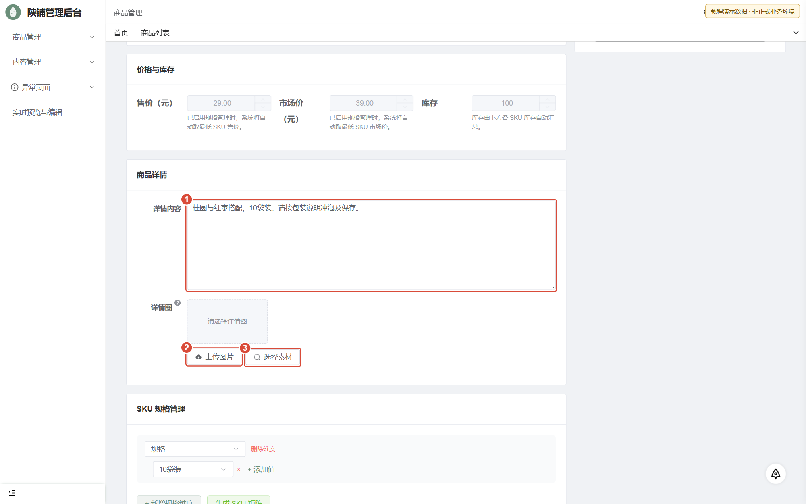

已有内容带网页标签时，保留原有格式；需要调整格式时，请联系维护人员。

## 08｜改售价、市场价和规格

### 8.1 商品规格与 SKU

“桂圆红枣茶”是一个商品；“10袋装”和“20袋装”是它的不同规格。后台把每种可售规格称为 **SKU**。每行规格可以有自己的价格、库存和图片。

标注“元”的价格框按人民币元填写。例如售价29.90元，填 `29.90`，不要填 `2990`。

### 8.2 已有商品改价

1. 找到“价格与库存”和下方的 SKU 表格。
2. 在下方 SKU 表格逐行修改图中 **①价格（元）**，售价要大于0。上方的售价显示各规格中的最低价。如果旧商品尚无 SKU，直接在“价格与库存”区域修改售价。
3. 如需展示市场价，填写合理的“市场价（元）”；填写时不要低于对应售价。
4. 核对每个规格，尤其是同一商品有多个包装或容量时。
5. 只调价时，保留图中 **②库存** 和规格结构。点“保存修改”，重新进入检查。

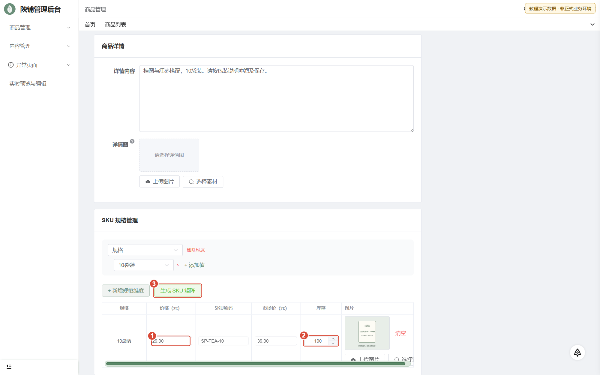

图中 **③生成 SKU 矩阵** 用于新建或调整规格组合。只改名称、价格或图片时，保留原有规格维度和矩阵。

上方库存为各 SKU 的汇总时，输入框显示灰色，需要在对应规格行调整。日常到货和盘点可使用第10节的库存工作台。

## 09｜保存商品

1. 核对名称、图片、分类、每个规格的价格、库存及上架状态。
2. 向下滚动，点击图中 **①保存修改**。
3. 如果保存失败，按提示检查对应字段。只改名称时，系统也会检查原有分类、图片和规格。旧商品尚无 SKU 时，单规格保存会用表单里的售价和库存补齐默认规格。选了“多规格”时，先生成 SKU 矩阵并填写各规格资料。
4. 保存后，页面返回商品列表，并提示“保存成功”。
5. 再次点击该商品“编辑”，核对刚才的内容仍在。随后按第15节检查小程序效果。

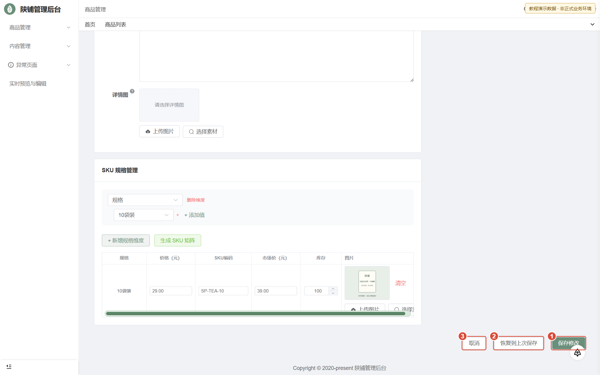

图8的 **②恢复到上次保存** 用于撤销当前页尚未保存的修改；**③取消** 用于退出编辑。

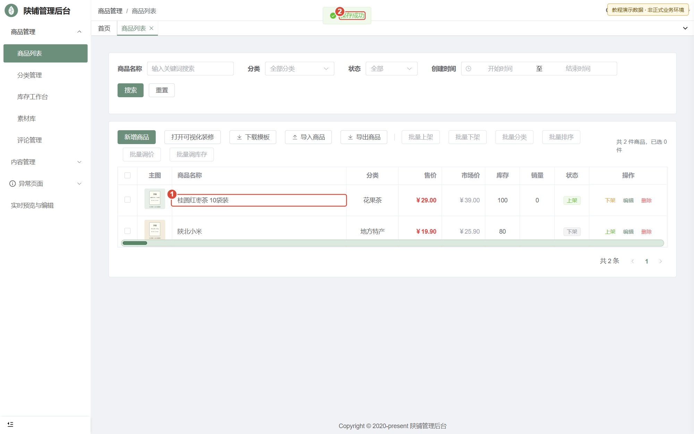

右侧预览会随输入变化。出现“有未保存修改”时，点击“保存修改”，成功后内容写入正式商品数据。装修页的“确认发布”是另一项操作，见第13节。

## 10｜到货补库存，或盘点减少库存

入口：**商品管理 → 库存工作台**。

1. 在图11的 **①商品名称** 搜索商品。
2. 核对商品名、SKU编码和“规格”，确认要改的是哪一行。多个规格需要分别处理。
3. 点击该行 **②调库存**。
4. 在图12的 **①调整数量** 填写增减件数，使用非零整数。减少件数时填负数，调整后的库存须在0至100万件之间。
5. 在 **②调整原因** 填写真实原因，4至200个字符，例如“到货入库20件”。
6. 检查数量和原因，点 **③确认调整**。
7. 返回列表核对新库存；需要追溯时，点图11的 **③流水**。

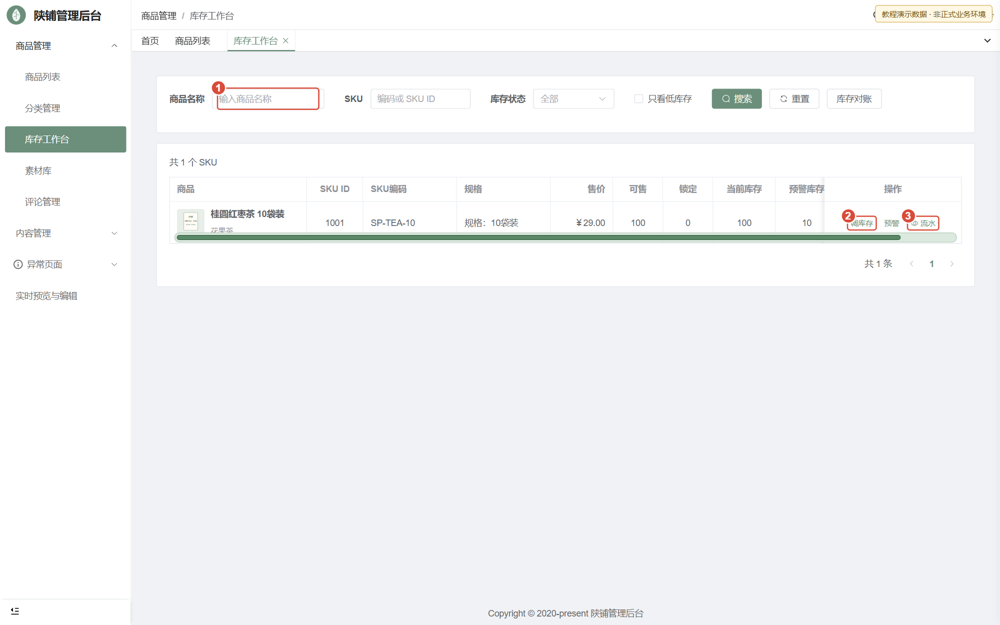

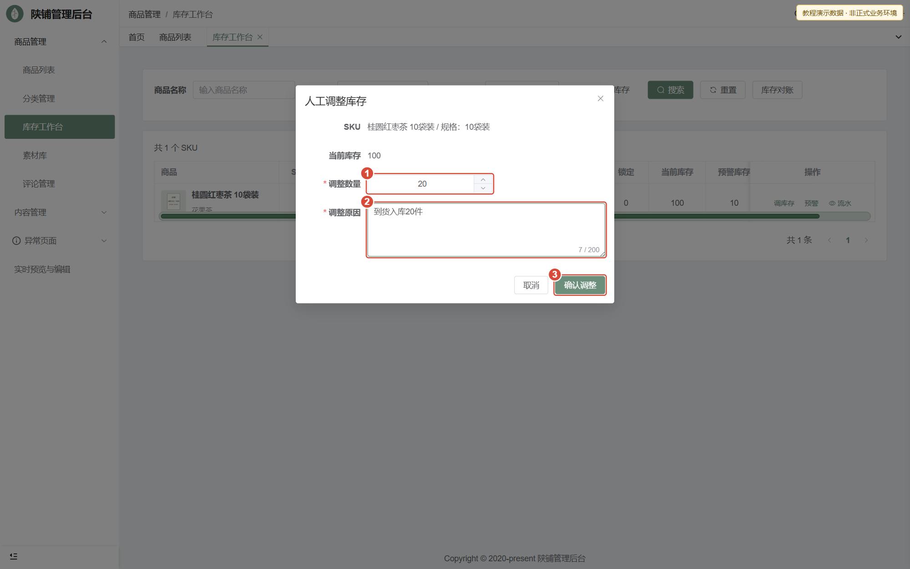

| 当前库存 | 操作 | 调整数量 | 调整后的库存 |
| --- | --- | --- | --- |
| 100件 | 新到20件 | `20` | 120件 |
| 100件 | 盘点少了5件 | `-5` | 95件 |
| 100件 | 希望总数变成120件 | `20`，不是120 | 120件 |

“可售”“锁定”和“当前库存”分别反映可购买数量、订单占用和库存记录。核对时先确认规格，再看可售数量；锁定数量按订单处理情况核对，不能直接作为盘亏扣减。若提示“库存已变化”，刷新列表并按最新库存重新核算调整数量。

如果在商品编辑页直接改 SKU 库存，那里的“库存”填写的是该规格库存值；保存时同样要填写调整原因。它与库存工作台的“调整数量”含义不同。

## 11｜商品上下架

入口：**商品管理 → 商品列表**。

1. 搜索目标商品并核对名称。
2. 当前上架的商品，操作区显示“下架”；当前下架的商品显示“上架”。
3. 点击对应操作，阅读确认框中的商品名称。
4. 名称正确时点“确定”；不正确时点“取消”。
5. 操作成功后核对“状态”列，再去小程序检查。

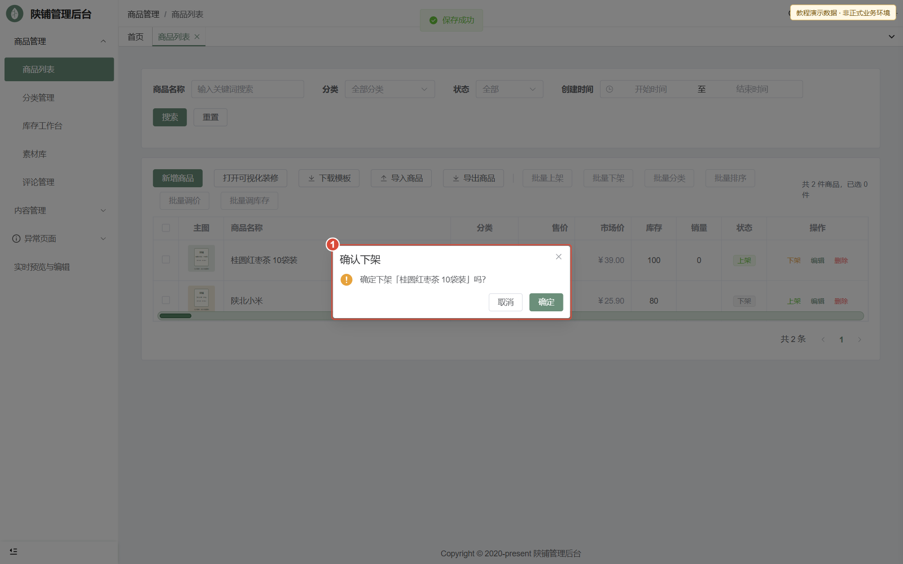

临时停售选择“下架”，保留商品信息。重新上架前检查主图、售价、规格和可售库存；校验未通过时，按提示补齐后重试。

## 12｜新增一个商品

入口：**商品管理 → 商品列表 → 新增商品**。

1. 填写“商品名称”和“商品分类”，商品类型按实际选择。
2. 补充简介和关键词。
3. 录入时先选择“下架”状态，完成检查后再上架。
4. 上传主图，添加轮播图和详情说明。
5. 如果只有一种规格，保持“单规格”，填写大于0的售价和库存。需要展示市场价时，填写与售价相等或更高的金额。
6. 如果有多种规格，打开“多规格”，选择规格名称，点击“添加值”逐个录入规格值，再点击“生成 SKU 矩阵”。
7. 给每一行规格填写大于0的售价和库存。SKU编码可留空，填写时使用不重复的字母、数字、下划线或连字符，最多64位。
8. 点页面底部“创建商品”，等待“商品创建成功”。
9. 重新进入商品核对；确认后，在列表点“上架”，再检查小程序。

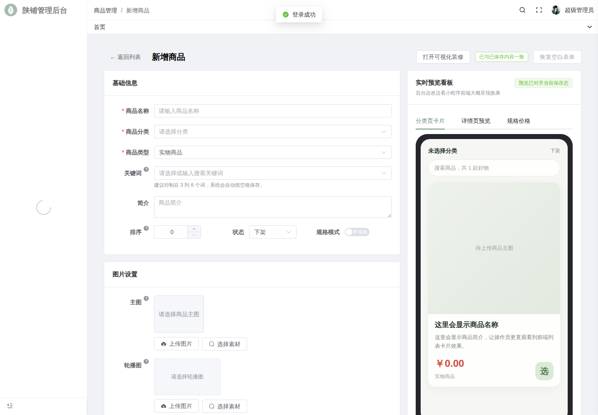

例如，规格名称选“净含量”，规格值填“250g”和“500g”，生成后会出现两行。分别填写并检查两行的价格和库存。

找不到合适分类时，联系分类负责人，或进入“商品管理 → 分类管理”新增分类，保存后回商品页面重新选择。

## 13｜更换首页图片、频道名称和推荐内容

入口：**可视化装修 → 实时预览与编辑**。

部分账号的左侧菜单会直接显示“实时预览与编辑”，点击该项即可。

账号同时具备商品和运营内容查看权限时，菜单会显示装修入口。要修改首页内容，还需内容维护权限。

左侧显示小程序预览，右侧显示选中内容的表单。点击带编辑标记的图片或卡片，即可在右侧修改；固定页面结构不支持直接编辑。

### 13.1 选择要修改的内容

1. 在“首页预览”中，点击图14的 **①带“点此编辑”的大图或卡片**。
2. 左侧只显示部分内容时，点击对应区块 **②查看全部**，再选择目标项目。
3. 右侧 **③编辑面板** 显示当前选中的内容；先核对名称，避免改错。

已停用的大图、频道、品牌和专题可到“内容管理”下对应页面查找和编辑。

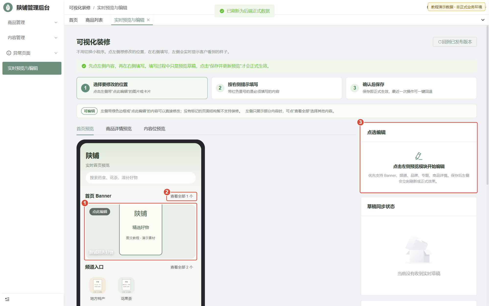

### 13.2 举例：更换首页大图（Banner）

1. 点击左侧目标大图。
2. 在图15的 **①标题** 中填写 Banner 标题，便于在后台识别这张大图。
3. 要更换顾客看到的画面，在“Banner 图片”点击上传或选择素材。图上的文字也要修改时，请先准备新的完整宣传图。
4. 如需点图进入某商品，使用“跳转目标”控件选择对应商品或页面；不需要跳转时可以留空。
5. 检查左侧草稿预览；有链接时可以点击“在预览中测试跳转”。
6. 完成后按下一小节发布。

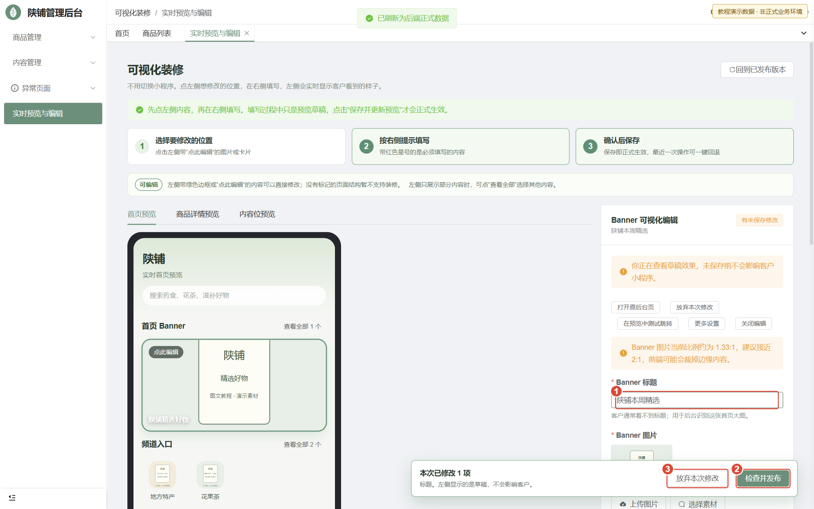

底部显示本次修改摘要，可在发布前核对修改项。

### 13.3 发布装修内容

1. 点击图15底部 **②检查并发布**。
2. 查看“发布前检查”弹窗，核对这次修改的是哪个字段。
3. 出现红色错误时，点击图16的 **①继续修改**，按提示补齐。
4. 出现图片比例、跳转等提醒时，逐项核对是否符合实际需求。
5. 确认无误后点击图16的 **②确认发布**。
6. 等待发布成功提示，再去小程序重新进入对应页面检查。

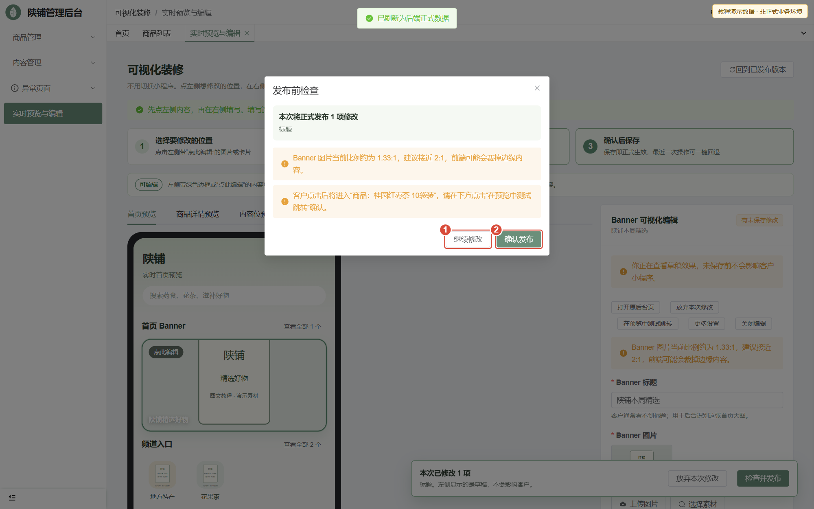

频道可修改名称、图标和跳转目标；推荐品牌可修改名称、图片和起售价；专题可修改标题、副标题、图片和价格说明。专题“价格说明”用于展示，关联商品的实际售价按第08节单独修改。

新增首页大图、频道、品牌或专题时，进入“内容管理”下对应页面，点击新增并保存，再回装修页核对。需要在图片上展示标题或商品名时，先准备带有相应文字的图片再上传。

## 14｜撤销修改与回退

### 14.1 还没有保存或发布

- **商品编辑页：** 点“恢复到上次保存”，撤回本页尚未保存的改动。新建商品页对应按钮是“恢复空白表单”。
- **可视化装修：** 点底部“放弃本次修改”；要重新读取正式数据，使用页面右上角“回到已发布版本”。
- 不确定当前是否保存成功时，先重新进入目标商品核对，不要连续多次提交。

### 14.2 已经保存或发布

1. 进入“可视化装修 → 实时预览与编辑”。
2. 在右侧向下找到“商品一键回退”或“内容一键回退”。
3. **核对操作名称、商品或内容名称、时间**。同一对象有较新的操作时，系统会拦截旧记录的回退。
4. 确认要恢复该次操作前的整份记录，再点击“一键回退”和“确认回退”。商品回退可能同时恢复价格、规格、库存和上下架状态，回退新增操作会尝试移除该商品。只需改回某个字段时，可打开商品重新编辑该字段。
5. 看到“已回退到最近一次修改前状态”后，回到原页面和小程序检查结果。

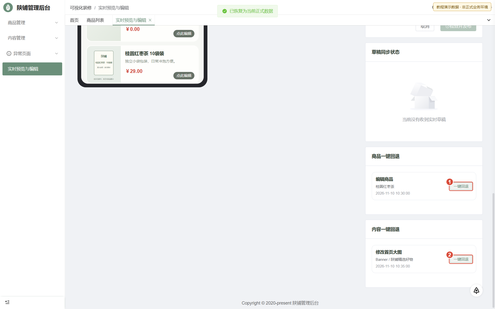

可回退范围以面板列出的记录为准。没有对应记录时，重新编辑正确值或联系负责人；其他历史操作、图片删除和库存流水等需另行核对处理。

## 15｜检查小程序显示

1. 用微信重新进入“陕铺”小程序，打开刚修改商品所在的页面；必要时下拉刷新或退出后重新进入。
2. 搜索新名称，检查商品及所属分类。
3. 查看列表主图，进入详情后左右滑动轮播图，再向下查看详情图片。
4. 打开规格选择，逐个核对不同规格的价格，并与列表起售价比对。
5. 检查对应规格的购买状态；下架商品应停止作为在售商品展示。
6. 如果装修页正常、小程序没有变化，先确认“确认发布”是否成功，以及登录的后台是否与当前小程序属于同一套环境。

显示效果在商品页面和规格选择中检查即可。如需交易测试，使用负责人指定的测试方式。

## 16｜常见问题

| 看到的现象 | 先做什么 | 仍未解决时 |
| --- | --- | --- |
| 登录提示账号或密码错误 | 检查大小写、空格和是否使用分配账号 | 请负责人重置密码 |
| 页面显示“当前账号无权访问该功能” | 点“返回工作台” | 请负责人检查该功能的账号权限 |
| 登录或打开页面提示“系统异常” | 记录发生时间、页面和提示，刷新一次 | 联系技术负责人检查服务 |
| 看不到某个菜单或编辑按钮 | 确认账号与负责人提供的一致 | 请负责人检查角色权限 |
| 搜索不到商品 | 点“重置”，去掉分类、状态条件后再搜 | 核对是否进入正确后台环境 |
| 改了预览，顾客看不到 | 商品页点“保存修改”；装修页完成“确认发布” | 重新进入小程序，核对环境 |
| 图片上传失败 | 检查JPG/PNG/WebP格式、单张不超过5MB | 换一张正常图片重试，并保留报错 |
| 上架时提示缺主图或价格不合法 | 按提示补主图、售价、规格和库存 | 联系负责人核对商品资料 |
| 库存变化后不能保存 | 按提示填写4至200个字符的真实原因，或刷新后按最新库存重算 | 核对规格和调整后的库存 |
| 名称重复或跳转目标冲突 | 阅读提示指出的对象，修改本次冲突项 | 请内容负责人确认保留哪一项 |
| 表格右侧按钮看不到 | 拖动表格底部横向滚动条向右 | 将浏览器缩放恢复到100%后再看 |
| 微信里仍是旧小程序名称 | 请管理员核对微信公众平台账号名称 | 检查平台提示及新版本发布状态 |

反馈问题时，写明页面、操作、发生时间、完整提示、商品名称及规格，以及已经尝试的处理方式，并附上提示截图。反馈内容不包含账号密码。

## 17｜开通客户账号与权限

由交付负责人在正式后台创建账号并分配权限。

1. 进入“系统管理 → 角色权限”，查看现有角色是否适合商品运营。
2. 需要商品编辑时，授予商品管理的查看、维护能力；需要上传或选图时，包含素材查看和素材维护能力。
3. 需要客户自己改首页大图、频道和专题时，授予内容查看和内容维护权限。即使客户只维护首页，装修页也需要商品查看权限来加载预览和跳转目标。
4. 打开“系统管理 → 管理员账号”，点击“新增管理员”。输入账号、姓名和初始密码，选择至少一个已启用的角色，再点“保存”。账号以英文字母开头，使用英文字母、数字、点、下划线或连字符，长度3至64位。初始密码须包含英文字母和数字，至少10个字符，最多72字节。英文字母、数字和英文标点每个占1字节。
5. 用新账号从登录页进入，确认默认打开账号有权限的页面，再检查商品列表、编辑页及所需的素材和装修页面。
6. 正式后台网址、账号和初始密码由负责人单独交给指定使用者。

“商品维护”权限同时包含新增、上下架、删除和批量操作。若只开放名称等指定字段，交付前需由维护人员拆分权限。

微信公众平台的管理权限单独分配，官方小程序改名由对应管理员操作。

## 18｜维护后检查

- 确认改的是正确商品与规格。
- 名称、分类、图片与详情内容一致。
- 价格按“元”填写，每个规格都已检查。
- 库存增减数量正确，调整原因清楚。
- 上下架状态符合本次目的。
- 已看到保存或发布成功提示。
- 重新进入页面核对，微信小程序展示也正确。

如果需要把教程发给其他人，请发送整个教程文件夹的压缩包，保留其中的“images”图片文件夹；只发HTML文件会导致截图缺失。
